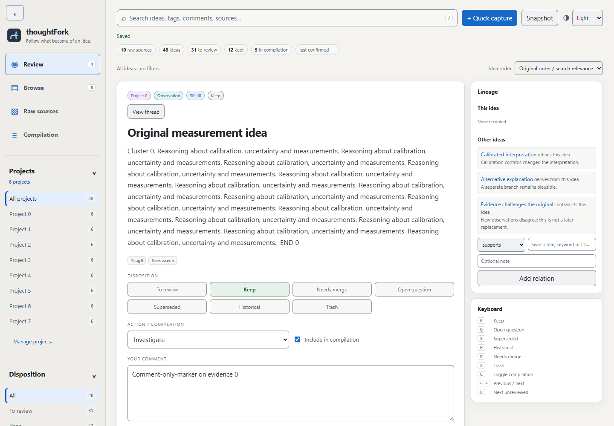
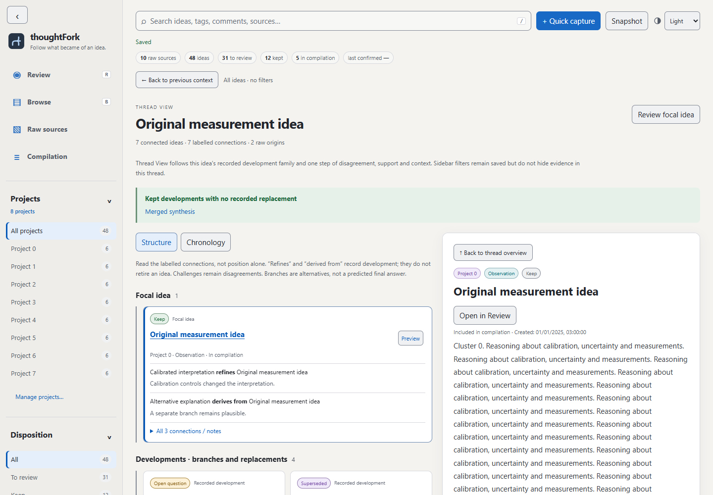

# thoughtFork

**Follow what became of an idea.**

thoughtFork is a local-first tool for turning messy notes into traceable ideas.

A single note may contain several thoughts. Over time those thoughts may be refined, contradicted, merged, superseded, or retained as historical context. thoughtFork preserves the original source while letting you review and follow what each idea became.

**A note is the container; an idea is the unit of judgment.**

```text
raw source → ideas → review → refinement / contradiction / merge / supersession → current thinking
```

**Superseded is not deleted.** Thread View shows where an idea came from and what it became, including branches, disagreement and contributing sources.





## Why thoughtFork exists

A folder of notes preserves what you wrote, but can make it hard to distinguish current thinking from an earlier claim. thoughtFork keeps raw evidence intact and gives each extracted idea its own review, relationships and recorded development. All screenshots show synthetic test data.

## Windows: open it like an application

1. Install **Node.js 20 or newer** from [nodejs.org](https://nodejs.org/).
2. Clone/download this application and extract it to a folder you will keep.
3. Double-click **Setup thoughtFork.vbs**. Choose whether to add a Desktop shortcut as well as Start Menu.
4. Open **thoughtFork** from Start Menu.

The launcher starts the local server quietly when needed and prefers a clean Microsoft Edge app window. If Edge is unavailable, it opens your normal browser. Opening the shortcut again reuses the existing server and tries to focus the existing app window. No terminal needs to stay visible. Setup is current-user only, needs no Administrator permission, and can be run again to update the shortcut after moving the folder.

On a genuinely new clone, choose **Create an empty notebook** and confirm the reviewed empty notebook, or import your own ledger JSON. Nothing is seeded on startup. Existing or damaged notebooks are never replaced by setup or launch.

If upgrading from an already-running Research Ledger/Threadmark server, stop that older server normally with Ctrl+C once before using the new launcher. The launcher will not kill it or start a competing writer.

## Developer/manual startup (Windows, macOS and Linux)

No application dependencies or cloud services are required. From the project folder:

```sh
node server.js --open
```

The manual Node server is also the macOS/Linux route; the Windows shortcut setup is Windows-only. Automated desktop verification currently targets Windows and Edge.

Open http://127.0.0.1:4173 if a browser does not open automatically. A manual terminal-started server stops with Ctrl+C. The original run-research-ledger.bat/.ps1 scripts remain available as visible developer launchers.

Closing the app window can leave its small local server running; relaunch reuses it. To stop a launcher-started hidden server, first finish pending saves/retained drafts, then use Windows Task Manager → Details to end only its node.exe PID shown by http://127.0.0.1:4173/api/health. Do not end unrelated Node processes. This is a deliberate manual stop, not part of ordinary launch. Windows ends the process normally at session shutdown.

To remove only the thoughtFork shortcuts:

```powershell
powershell.exe -NoProfile -ExecutionPolicy Bypass -File .\setup-thoughtfork.ps1 -RemoveShortcuts
```

This does not stop the server or delete the application, notes, backups, logs or browser preferences. See [Windows launch design and troubleshooting](docs/windows-launch.md) for browser fallback, startup errors, logs and local restrictions.

## Where your notes live

The server binds to the local loopback interface. There is no account, hosted sync or automatic AI service. Notes, exports, backups and browser drafts stay on your machine unless you deliberately share them. Other people or programs with access to your computer may still access local data; this is not encrypted storage.

Your private notebook is data/ledger.json; backups are under data/backups/. Both are excluded from ordinary Git additions. No personal corpus is bundled or seeded. Keep separate backups before moving or publishing the code.

## Backups

The server writes timestamped backups to:

`data/backups/`

- Ordinary idea edits attempt a pre-change backup after ten minutes since the last successful backup (including the first edit after startup). These periodic snapshots are best effort and failures are shown. Quick Capture always requires its own verified pre-change backup.
- The **Snapshot** button creates an immediate manual backup.
- Importing a ledger requires a reviewed replacement preview and a verified pre-import backup first. Empty replacement requires an extra acknowledgement. Malformed canonical files open Recovery mode; restoration preserves damaged bytes before replacing them.

## Review model

Each idea has separate fields for:

- **Disposition:** To review / Keep / Needs merge / Open question / Superseded / Historical / Trash. Existing Archive records remain readable and filterable. “Needs merge” retains the stored legacy `Merge` value; it does not claim a completed merge.
- **Action:** None / Discuss / Investigate / Verify / Build
- **Compilation:** include/exclude
- **Comment:** your reasoning
- **Lineage:** supports / contradicts / refines / supersedes / derived-from / merged-into / related-to another idea

This is intentional: an idea can be historical *and* worth discussing; superseded *and* still useful as lineage; current *and* still require verification.

## Keyboard shortcuts in Review mode

- `K` Keep
- `Q` Open question
- `S` Superseded
- `H` Historical
- `M` Needs merge
- `X` Trash
- `C` Toggle compilation inclusion
- `←` / `→` Previous / next visible idea
- `U` Next unreviewed idea
- `/` Focus search
- `R` Review view
- `B` Browse view

## Quick capture

Use **+ Quick capture** for the same habit you used Notepad for. The app saves the raw note as a source *and* creates a reviewable item. It does not try to AI-compress it locally.

When you want ChatGPT to clean/extract/recompile the new material, export `data/ledger.json` (or use **Export ledger JSON**) and upload it to the chat.

## Git and publication

The ignore rules exclude data/ledger.json, data/ledger-before-codex.json and backup contents. Ignore rules do not remove files already committed: inspect tracked files and repository history before publication. Keep research exports and browser-profile/draft contents private.

## Design principle

Raw source is the lossless layer. Extracted ideas are the review layer. Compilations are derived outputs.

Deleting or superseding an idea in the review layer does **not** rewrite the original raw source.

## Trustworthy persistence

The server owns a single writer per ledger, serializes mutations, and rejects conflicting stale edits. Different ideas can be changed safely from stale tabs. Ordinary saves never replace the whole ledger with browser state. Load does not migrate or rewrite existing research.

The save indicator distinguishes Unsaved, Saving, Saved, Save failed, and Conflict. Failed editor saves keep entered values. Comments and editor/capture drafts are retained locally across ordinary same-tab reload; cancel closes the modal but keeps a changed draft. Use **Discard draft** to remove it deliberately. Storage failure is visible; save/copy private drafts before closing a tab. JSON export fetches confirmed server state and excludes drafts.

Stop all older Research Ledger server processes before starting this version. After upgrading, refresh existing browser tabs. Old clients cannot save without the new preconditions. The writer lock is released by the operating system after normal exit or a crash.

Run `npm test` for dependency-free synthetic-data regressions. See [the save contract, guarantees, known limits, optional browser tests and manual restore drill](docs/persistence.md). No test uses the real data folder. Backups have no automatic pruning. This is not a guarantee against drive failure or sudden machine power loss.

## Sources and idea evolution

Use **Create idea from this source** in Full Source or Raw Sources to record more ideas from an existing note. Select a passage first in Full Source for an exact range, or paste a unique excerpt. **Save and create another** keeps the source open. Raw text remains unchanged.

Open **Sources & evolution** on an idea to see all origins, predecessors, later developments, latest linked inheritors and recorded changes. Add contributing sources there, or use **Merge with other ideas…** to review participants, choose an existing survivor and write the resulting text yourself. Explicit confirmation commits all participants together. Contributors remain readable with their comments and original content. Every compilation selection remains unchanged.

Adding a **supersedes** relationship asks for confirmation, marks the older idea Superseded and records both sides of the change. Incoming links are computed. Contradiction does not change disposition. Replacement cycles are rejected. Compilation warns about included obsolete ideas and omitted successors; it never changes inclusion for you.

See [the model and workflow design](docs/evolution.md) for backwards compatibility, history and limits. History begins with new saved actions; no prior history is invented. New extraction, merge and supersession operations require verified pre-operation backups; source attachment uses ordinary periodic backups. Failed/conflicting drafts remain available for explicit review or discard.

## Finding and revisiting ideas

Search matches all typed words, case-insensitively, across the fields of each record. Results label Title, Summary, Tags, Comment and other matching fields. A match found only inside a raw source appears as a source result; open it to see all contributing/derived ideas. It does not claim every linked idea independently matches. Browse, Raw Sources, lineage and merge use the same rules. No fuzzy matching or query syntax is required.

Global suggestions include **See all results**. Complete results, Browse, Raw Sources, lineage, merge and Full Source contributions have pages, totals and direct page-number navigation. Use arrows and Enter in suggestions/candidate lists; **F2** or **Preview** opens complete scrollable content, and Escape closes it. Touch/small screens use explicit previews. Result titles still open the idea or reader. **Back to previous context** restores filters, query, page, scroll and result focus after a jump.

The sidebar can collapse to a navigation rail; Projects, Disposition and Action independently collapse. On small screens, open the rail's filters control to reach the drawer, including export/import. Collapse preferences, pins, view, filters, selected idea, page, sort and reading position stay locally in this browser per ledger. They do not modify research data. Recently edited/reviewed/created sorts use saved timestamps; records without timestamps sort last. Moving to another idea starts at the top. A filtered-out review item advances to its next surviving neighbor, then the preceding one if necessary.

**Manage projects…** shows idea/source assignment counts, pin/unpin and rename. Pins appear first and stay local. Create empty projects and move projects up/down within their pinned/unpinned group. Explicit order travels with the ledger; otherwise discovered names are alphabetical. Empty projects can be hidden locally. Rename updates every matching idea/source assignment in one transaction after a required verified backup. Renaming into an existing exact-name project requires explicit combination acknowledgement. Original raw text, comments, provenance, completed merges and existing history remain; affected ideas gain a project-renamed history event. Semantic dispositions remain fixed. Save/review retained drafts before managing assignments.

Single-key shortcuts can be turned off in sidebar settings. Full Source retains reading controls and adds searchable, paged contributions. thoughtFork is the visible working product name. See [retrieval design, benchmarks and limits](docs/retrieval.md).

## Appearance

Choose **System / Light / Dark** in the header. System is the default and follows operating-system changes while the app is open. Explicit choices are remembered locally for this browser origin and synchronize across its tabs. If storage is unavailable, the selected palette still works for the visit and a notice explains that it could not be saved. Appearance never changes research, exports, navigation or draft state.

Both palettes cover the reader, previews, review controls, tables, dialogs, lineage and recovery surfaces. The warm neutral Light palette and graphite Dark palette share semantic state colors, clear focus and reduced-motion behavior. See [the appearance design and verification notes](docs/appearance.md).

## Thread View

Choose **View thread** from Review, Browse, search/preview, Sources & evolution or a Full Source contribution. The focal view shows recorded development, branches, challenges, completed/legacy merges, supersession and contributing raw sources. Select a title to read complete content, comments, provenance and recorded changes; Preview/F2 works without leaving the view. Make a selected idea focal to explore its neighbourhood, or open it in Review. Back restores your previous context, including a source reader.

**Structure** shows labelled connections; **Chronology** shows threadmarks derived from actual recorded changes and explicitly labelled known timestamps. It never reconstructs unrecorded past states. Filters remain saved and visible but do not hide evidence in a focal thread. See [the derivation, limits and project metadata design](docs/threadmark.md).

## Contributing

For source-note editing/history, capture stacks and shortcuts, close/reopen draft recovery, source sorting, Undo, Recent/pins, tags, internal links and batch organisation, see [Everyday use](docs/everyday-use.md). Source edits are versioned; existing extracted ideas and historical excerpts remain tied to their recorded source text.

See [CONTRIBUTING.md](CONTRIBUTING.md) for setup and regression checks, [SECURITY.md](SECURITY.md) for private vulnerability reporting, and [LICENSE](LICENSE) for the MIT licence. Use synthetic notebooks in issues, tests and screenshots.
